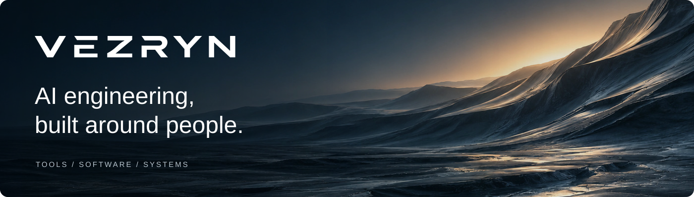

  

  <a href="https://vezryn.com/">Website</a> ·
  <a href="https://vezryn.com/products/">Products</a> ·
  <a href="https://www.linkedin.com/company/vezryn/">LinkedIn</a> ·
  <a href="https://vezryn.com/#contact">Get in touch</a>

## Making AI useful

Vezryn is an AI engineering company building tools, software, and systems for people and organizations. We start with the person, the problem, and the intended outcome, then build around the work.

### What we're building

**[Friday](https://vezryn.com/products/)** · In development  
A personal AI workspace that brings conversations, context, and connected tools together in a customizable desktop environment.

**[Wednesday](https://vezryn.com/products/)** · In development  
An engineering workspace for AI-assisted development, designed to help people direct coding sessions, coordinate tasks, and follow the work in one place.

**[Graph Community](https://github.com/Vezryn-LLC/graph-community)** · Open source · Apache-2.0

A headless engineering coordinator that turns ready issues in explicitly enrolled GitHub repositories into ordinary pull requests using native Codex workers. Bring your own GitHub access and Codex tools; see the quickstart for requirements and platform limits.

[Explore the source](https://github.com/Vezryn-LLC/graph-community) · [Try the quickstart](https://github.com/Vezryn-LLC/graph-community/blob/main/QUICKSTART.md) · [Graph product & workflow film](https://vezryn.com/products/graph/#film)

Graph Community is the public, headless edition. Vezryn's private Graph features and metrics are separate and are not included. The workflow film uses illustrative interface footage to explain the flow.

### How we work

- **Understand** the person, the problem, and the outcome that matters.
- **Engineer** the tools and capabilities that fit the work.
- **Evaluate** in real use, test assumptions, and refine.

Usability, reliability, cost, privacy, security, and adaptability shape the way we build.

---

**What do you want to accomplish?** [Start a conversation →](https://vezryn.com/#contact)
